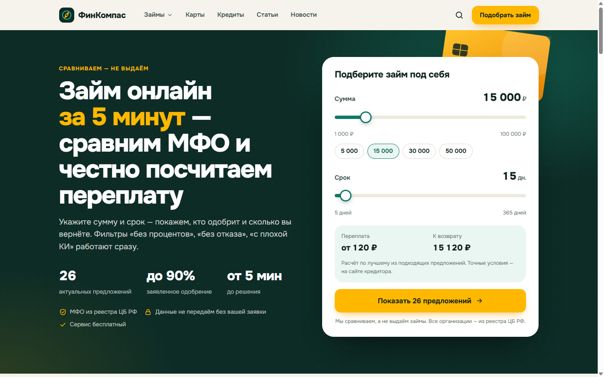
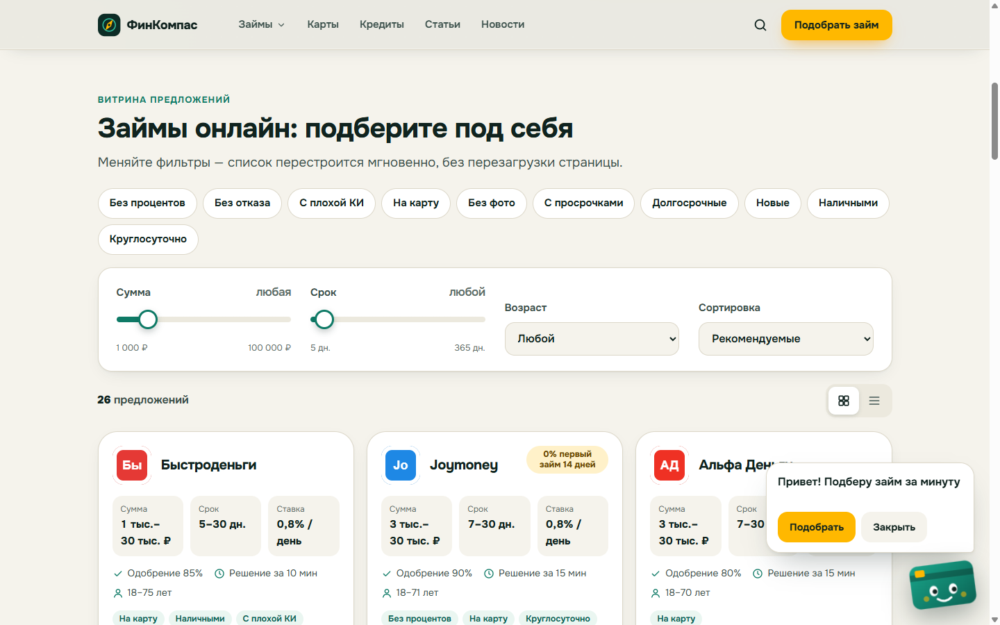
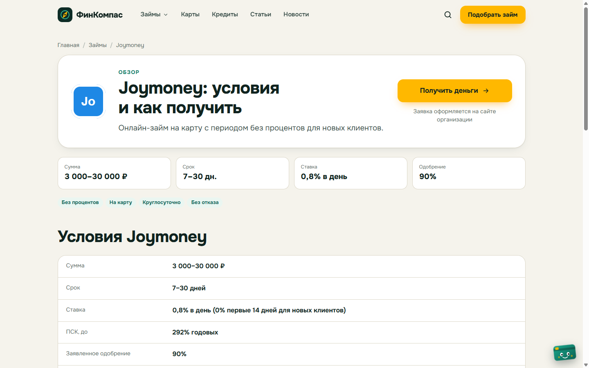
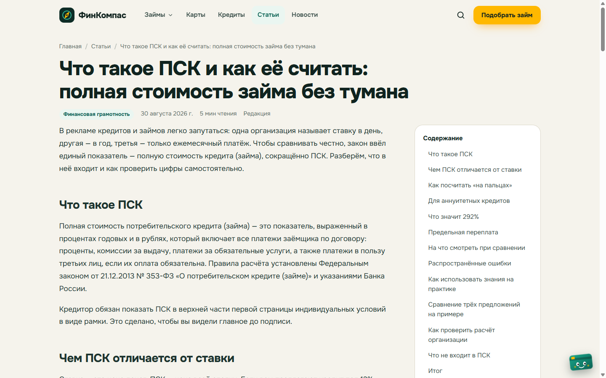
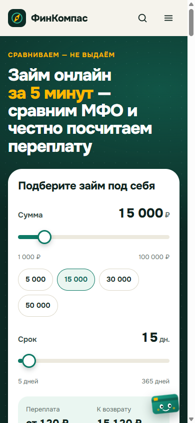
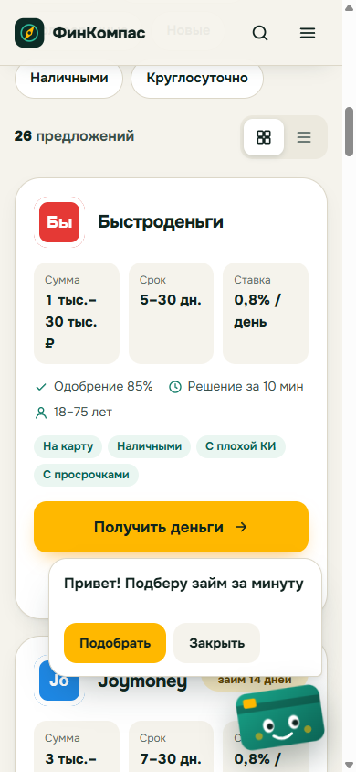

# Finance Arbitrage — фабрика финансовых CPA-сайтов

Сетка контентных сайтов про займы, кредиты и карты. Монетизация — CPA-офферы Saleads.
Каждый сайт: витрина офферов с фильтрами + блог + новости, статический билд на Astro,
деплой на Beget.

Первый сайт сети — **пилот rencredit-online.ru** (рабочее имя бренда «ФинКомпас»),
фронт в [`web/`](web/).



| Витрина с фильтрами и маскотом | Обзор МФО | Статья с оглавлением |
|---|---|---|
|  |  |  |

| Мобильная главная | Маскот-карта на мобиле |
|---|---|
|  |  |

---

## Быстрый старт

Нужно: **Node 22+**, npm. Для Python-пайплайна (офферы Saleads) — [`uv`](https://docs.astral.sh/uv/).

```bash
git clone https://github.com/InfernYaCr/Finance_arbitrage
cd Finance_arbitrage
git checkout feat/rencredit-pilot

npm --prefix web install                       # зависимости фронта (npm workspaces)
npm --prefix web/apps/rencredit run dev        # http://localhost:4321 — дев-сервер
```

Прод-сборка и превью:

```bash
npm --prefix web/apps/rencredit run build      # → web/apps/rencredit/dist (статик)
npm --prefix web/apps/rencredit run preview -- --port 4330
```

Проверки (их же гоняет Stop-хук Claude Code):

```bash
node scripts/check.mjs --quick                 # исходники: бренды донора, rel у /go/, офферы
node scripts/check.mjs                         # полная: build + аудит dist
node web/scripts/check-content.mjs             # офферы ↔ пул Saleads, реестр ЦБ, лимиты ставок, логотипы (входит в check.mjs)
node web/scripts/sync-cbr-registry.mjs         # снимок реестра ЦБ (МФО + банки) -> src/data/cbr-registry.json, раз в неделю
ALLOW_STALE=1 node scripts/check.mjs           # срочный деплой: устаревшие checkedAt/снимок ЦБ — предупреждение
npm --prefix web/apps/rencredit run check      # astro check (типы)
```

Python-окружение (нужно только для работы с офферами и старым пайплайном):

```bash
uv venv .venv --python 3.11
uv pip install --python .venv/Scripts/python.exe -r requirements.txt   # macOS/Linux: .venv/bin/python
```

Подробности по Windows — [docs/harness/ENV.md](docs/harness/ENV.md).

---

## Как это устроено

```
sites/affiliate_pool.json         ← 189 офферов Saleads (выгрузка site_pipeline/saleads_offers.py)
        │  node web/scripts/sync-pool.mjs
        ▼
web/packages/core                 ← офферы, фильтры, переплата, JSON-LD, SEO (чистый TS)
web/packages/motion               ← переходы, анимации, маскот (переиспользуется сайтами сети)
        │
        ▼
web/apps/rencredit                ← Astro 7 + Tailwind 4 + GSAP
  src/content/offers/*.json       продукты с условиями (poolId → оффер Saleads)
  src/content/guides/*.mdx        посадочные: «без отказа», «без процентов», …
  src/content/articles/*.mdx      статьи блога
  src/content/news/*.md           новости (только реальные, с source)
  src/content.config.ts           Zod-схемы — источник правды по полям
  src/pages/go/[offer].astro      редирект на оффер с UTM, noindex
        │  npm run build
        ▼
dist/  ── FTP ──▶  Beget          (.github/workflows/deploy-rencredit.yml, ручной запуск)
```

**Контент пишется в markdown**, донор не краулится. Опечатка во frontmatter роняет сборку —
так и задумано.

### Страницы

| URL | Что |
|---|---|
| `/` | Hero с калькулятором суммы/срока и расчётом переплаты, витрина офферов, топ-5, статьи, FAQ |
| `/<guide>/` | Посадочные с предустановленным фильтром (`/zaimy-bez-otkaza/`, `/zaimy-bez-procentov/` …) |
| `/zaimy/`, `/karty/`, `/kredity/` | Каталоги |
| `/mfo/<slug>/` | Обзор оффера: условия, плюсы/минусы, CTA |
| `/stati/`, `/novosti/` | Блог и новости |
| `/go/<poolId>/` | Редирект на Saleads (noindex, `Disallow` в robots.txt) |

### Витрина и фильтры

Фильтры работают на клиенте без перезагрузки: сумма, срок, возраст, 10 чипов-фич
(`zero_percent`, `no_refusal`, `bad_history`, …), сортировка, сетка/список.
Состояние живёт в URL (`?sum=&term=&f=&sort=&view=`), карточки перестраиваются через GSAP Flip.

### Motion

- View Transitions между страницами (логотип оффера морфится в hero обзора).
- 3D-карта в hero реагирует на курсор, счётчики, появление блоков.
- **Маскот-кредитка**: при первом визите выезжает, когда калькулятор ушёл с экрана, и говорит
  три фразы; дальше живёт иконкой. Флаг в `localStorage`.
- Только `transform`/`opacity`, `prefers-reduced-motion` гасит всё, GSAP грузится лениво.
  JS на страницу ≈12 КБ gzip (+36 КБ GSAP при первой фильтрации).

### Офферы

1. Обновить пул: `python site_pipeline/saleads_offers.py export-pool` (токен `SALEADS_API_KEY` в `site/.env`).
2. Скопировать во фронт: `node web/scripts/sync-pool.mjs`.
3. Продукт для витрины — JSON в `web/apps/rencredit/src/content/offers/` с `poolId` из пула.
4. `node web/scripts/sync-cbr-registry.mjs` (новый номер `cbrLicense` попадает в снимок реестра ЦБ), затем `node web/scripts/check-content.mjs`.

> ⚠️ Условия всех офферов заполнены по публичным данным и помечены `verified: false`.
> Перед продом — сверить с сайтами МФО и кабинетом Saleads.

---

## Разработка с Claude Code

В репо настроен харнесс — [docs/harness/README.md](docs/harness/README.md).

- **Хуки** (`.claude/settings.json`): `guard.py` блокирует чтение `.env`, `git push` агентом,
  массовые удаления, копирование файлов подтверждения Яндекса между сайтами (футпринт сети);
  Stop-хук запускает `scripts/check.mjs --quick`.
- **Скиллы** (`.claude/skills`): `site-design`, `motion-system`, `ymyl-content`,
  `offer-placement`, `news-pipeline` + `grill-me`, `to-spec`, `handoff`, `code-review`, `diagnosing-bugs`.
- **Субагенты** (`.claude/agents`, Sonnet): `ui-builder`, `motion-designer`, `content-writer`,
  `news-writer`, `ymyl-fact-checker`, `seo-auditor`, `page-reviewer`.
- **Команды**: `/check`, `/new-article <тема>`, `/new-news <тема>`, `/new-offer <poolId>`, `/review-page <url>`.

Параллельная работа агентов — по зонам владения папками (UI / контент+core / харнесс),
коммиты делает оркестратор.

---

## Старый пайплайн

`site_pipeline/` (краулер донора, QA, Saleads-клиент) и `site/` (рендерер на Astro 4) остаются
для сайта finhelp-ru. Контекст — [PROJECT_BRIEF.md](PROJECT_BRIEF.md), [AGENT_HANDOFF.md](AGENT_HANDOFF.md), [CLAUDE.md](CLAUDE.md).

## Что дальше

- [ ] Сверить условия офферов (`verified: true`), реестровые номера ЦБ
- [ ] Юр. реквизиты в футере, политика конфиденциальности (юрист)
- [ ] OG-картинки, Яндекс Метрика, Вебмастер
- [ ] Деплой на тестовый поддомен с `PUBLIC_NOINDEX=true`
- [ ] Перенос старых URL rencredit-online.ru (WP REST → `legacyUrl` → 301)
- [ ] Автопубликация статей и новостей по расписанию
